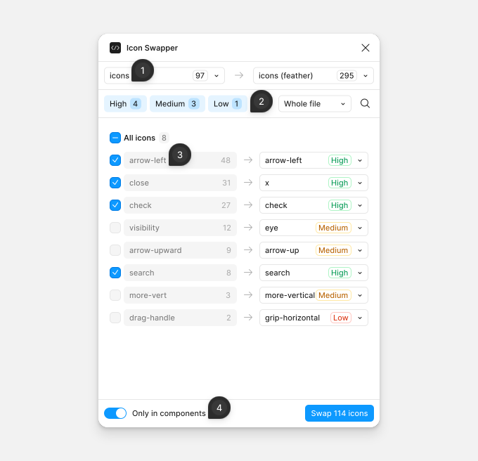

# Icon Swapper

Icon Swapper moves a file from one icon collection to another. It matches the icons by name, and you check every match before anything changes.

## Swap icons

Put your icon collections on a page whose name contains `icons`, one frame per collection with its icon components inside. Both collections must be in this file.

1. **The collections** — the collection you're replacing on the left and the one you're moving to on the right, each with its number of icons.
2. **The toolbar** — **High**, **Medium** and **Low** show or hide the matches of each confidence. The dropdown sets where to swap: **Whole file**, **This page** or **Selection**. The search button filters the list by icon name.
3. **A match** — the icon you're replacing, with the number of places it's used, and the icon it becomes, with the confidence of the match. Click the icon on the left to select those layers. To choose another icon, open the dropdown: the suggestions come first, then every icon of the collection. Choosing an icon checks its row, and an icon you choose yourself shows **Picked**.
4. **Only in components** — swaps only the icons inside your components, and leaves the icons placed directly in frames as they are.

High-confidence matches start checked. Review the rest and check the ones you agree with, or check **All icons** to select every row shown. Only the rows you can see are swapped: if you hide a confidence or search, the hidden rows stay as they are.

Click **Swap icons** to replace every checked icon. The button shows how many layers change, so you see the size of the swap first. Press Ctrl/Cmd+Z to undo. Swapped icons leave the list, so you can work through a large collection in rounds: swap the matches you trust first, then pick icons for the rest.

If a match looks wrong, check the names. The plugin compares them word by word and ignores sizes such as `24` or `small`, and words that most icons in a collection share, such as `icon`. It knows a few synonyms, so `close` finds `x` and `view` finds `eye`. For any other icon, pick the right one from the dropdown.
